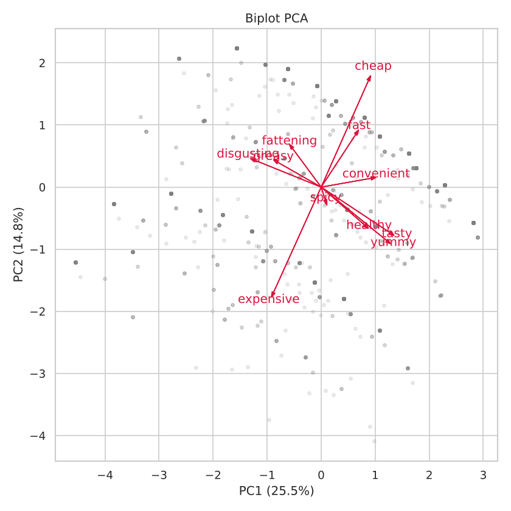
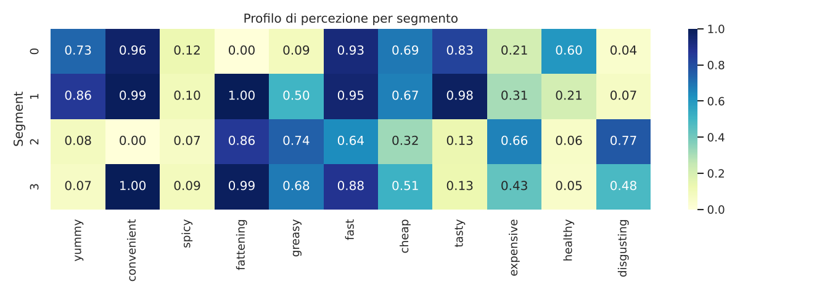

# Analisi del dataset McDonald's

Analisi delle percezioni dei consumatori sul brand McDonald's, svolta seguendo la pipeline di data analysis del corso di **Fondamenti di Scienza dei Dati** (Università di Palermo).

## Dataset

`data/mcdonalds.csv` – 1453 risposte a un sondaggio, 15 attributi:

| Attributi | Tipo | Descrizione |
|---|---|---|
| `yummy`, `convenient`, `spicy`, `fattening`, `greasy`, `fast`, `cheap`, `tasty`, `expensive`, `healthy`, `disgusting` | binari (Yes/No) | percezione del brand |
| `Like` | ordinale (−5 … +5) | gradimento complessivo |
| `Age` | numerico | età del rispondente |
| `VisitFrequency` | ordinale | frequenza di visita (da *Never* a *More than once a week*) |
| `Gender` | binario | Female / Male |

### Fonte

Il dataset proviene da:

> Dolnicar, S., Grün, B., Leisch, F. (2018). *Market Segmentation Analysis: Understanding It, Doing It, and Making It Useful*. Springer. https://doi.org/10.1007/978-981-10-8818-6

ed è distribuito anche come `mcdonalds` nel pacchetto R [`MSA`](https://cran.r-project.org/package=MSA). Il file è incluso qui solo a scopo didattico.

## Pipeline

1. **Data collection** – caricamento ed esplorazione
2. **Preprocessing** – data cleaning (missing values, duplicati, outlier), feature extraction (codifica binaria e ordinale), analisi esplorativa e correlazioni, z-score normalization
3. **Riduzione della dimensionalità** – PCA, scree plot e biplot
4. **Learning non supervisionato** – segmentazione con K-means (scelta di K con metodo del gomito e silhouette)
5. **Learning supervisionato** – classificazione di `Like > 0` con kNN e regressione logistica, model selection con `GridSearchCV` e cross-validation 5-fold
6. **Evaluation** – accuracy, precision/recall, matrice di confusione sul test set
7. **Prediction** – modello finale applicato a nuovi clienti

## Risultati principali

- **PCA**: PC1 (25.5% della varianza) è l'asse del *gusto* (`yummy`, `tasty` vs `disgusting`), PC2 (14.8%) quello del *prezzo* (`cheap` vs `expensive`). Servono 8 componenti su 11 per spiegare il 90% della varianza.
- **Segmentazione (K = 4)**:

  | Segmento | Quota | Profilo | Like medio |
  |---|---|---|---|
  | Fan attenti alla salute | ~12% | gustoso, non ingrassante, ritenuto sano | +2.7 |
  | Fan consapevoli | ~51% | gustoso e comodo, ma fa ingrassare | +2.3 |
  | Detrattori | ~8% | scomodo, disgustoso, caro | −3.3 |
  | Critici ma utilizzatori | ~29% | comodo ma non gustoso | −1.6 |

  I silhouette score bassi (≈ 0.23) indicano che i segmenti non sono nettamente separati.
- **Classificazione**: regressione logistica ≈ **85%** di accuratezza sul test set, kNN (k = 9) ≈ 84%. Gli attributi più influenti sono `yummy`, `tasty`, `disgusting` e la frequenza di visita.




## Conclusioni

Il gradimento di McDonald's dipende soprattutto da come viene percepito il **gusto**. `yummy` e `tasty` sono gli attributi più correlati con `Like` (0.68 e 0.64), mentre `disgusting` lo è in senso opposto (−0.58). Le percezioni su prezzo e salubrità pesano molto meno. La PCA conferma questa struttura: il primo asse, quello che spiega più varianza, separa chi trova il cibo buono da chi lo trova disgustoso, e il prezzo compare solo sul secondo asse.

Comodità e velocità sono riconosciute quasi da tutti (oltre il 90% dei rispondenti), quindi **non distinguono** chi apprezza il brand da chi non lo apprezza. Lo stesso vale per `fattening`: l'87% ritiene che il cibo faccia ingrassare, ma la metà del campione (il segmento dei *fan consapevoli*) lo apprezza comunque.

La segmentazione individua un gruppo particolarmente interessante dal punto di vista commerciale: i **critici ma utilizzatori** (circa 29%). Considerano McDonald's comodo e veloce ma non gustoso. Frequentano il brand per praticità, senza esserne soddisfatti, e un miglioramento della percezione del gusto potrebbe spostarli verso un giudizio positivo. I **detrattori** veri e propri sono invece una minoranza (circa 8%), con giudizio negativo su quasi tutti gli aspetti e visite molto rare.

Dal punto di vista predittivo, le sole percezioni permettono di stabilire se un cliente apprezza il brand con circa l'**85% di accuratezza**. Un modello lineare (regressione logistica) è sufficiente e leggermente migliore del kNN, segno che la relazione tra percezioni e gradimento è in gran parte lineare.

**Limiti**: i segmenti di K-means non sono nettamente separati (silhouette ≈ 0.23), perché i dati binari non formano gruppi naturali; vanno letti come una partizione utile e non come categorie reali di clienti. Inoltre la frequenza di visita è fortemente correlata con il gradimento (0.69), ma è più probabilmente una sua conseguenza che una causa.

## Struttura

```
mcdonalds-analysis/
├── data/mcdonalds.csv
├── notebooks/analisi_mcdonalds.ipynb
├── figures/                 # grafici generati dal notebook
├── requirements.txt
└── README.md
```

## Esecuzione

```bash
pip install -r requirements.txt
cd notebooks
jupyter notebook analisi_mcdonalds.ipynb
```

Il notebook va eseguito dalla cartella `notebooks/` (usa percorsi relativi `../data` e `../figures`).
